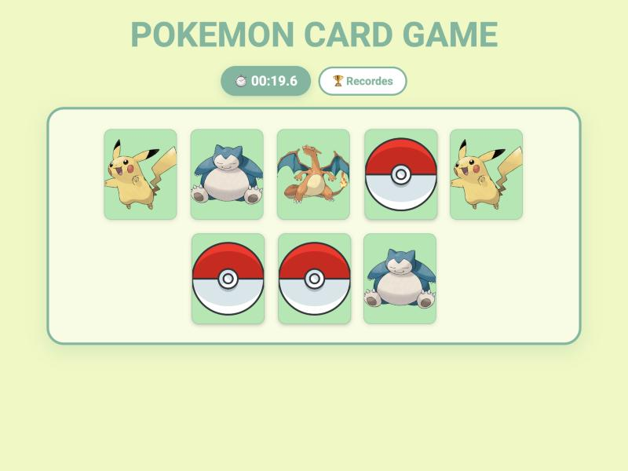
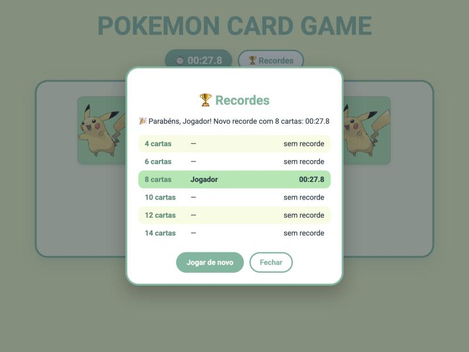
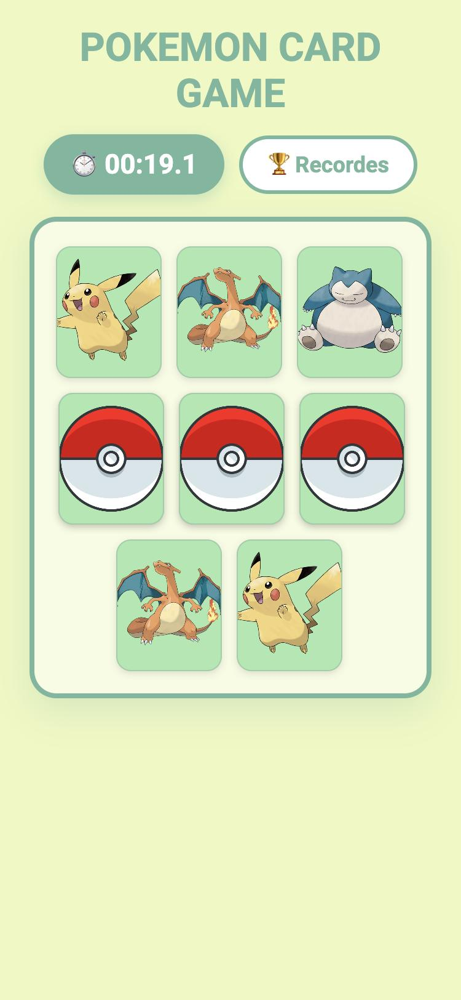

# ⚡ Pokémon Card Game

**Jogo da memória** com Pokémon: vire as cartas, encontre os pares no menor tempo possível e tente entrar para a tabela de **recordes online**.

Projeto feito durante o bootcamp da Driven (o "Parrots Card Game", aqui com tema de Pokémon), em **HTML, CSS e JavaScript puro**, com uma pequena API na Vercel para guardar os recordes.

### 🔗 [Jogue agora](https://projeto4-parrots-steel.vercel.app/)

<p align="center">
  
  
</p>
<p align="center">
  
</p>

---

## ✨ Funcionalidades

- **Quantidade de cartas:** ao abrir, o jogo pergunta com quantas cartas você quer jogar (número par de 4 a 14).
- **Cartas embaralhadas:** os pares são sorteados e embaralhados a cada partida.
- **Virar e comparar:** clique em duas cartas. Se forem iguais, ficam abertas; se não, viram de volta depois de 1 segundo. Clicar numa carta já aberta (ou numa terceira carta enquanto duas estão sendo comparadas) não faz nada.
- **⏱️ Timer:** começa na primeira carta virada e para quando o último par é encontrado (minutos:segundos.décimos).
- **🏆 Recordes online:** existe um recorde para cada quantidade de cartas, com o **nome** e o **tempo** de quem zerou mais rápido. Ele é o mesmo para todo mundo que joga pelo site.
  - Se você bater o recorde, o jogo pergunta o seu nome e salva.
  - Se não bater, mostra o seu tempo e quem continua com o recorde.
  - O botão **🏆 Recordes** abre a tabela a qualquer momento.
- **Jogar de novo:** recomeça a partida e pergunta a quantidade de cartas outra vez.
- **Layout responsivo:** as cartas ficam dentro de um container com borda arredondada e se ajustam ao celular.

---

## ⚙️ Como funciona por dentro

### Arquivos

```
├── index.html         # estrutura: título, timer, botão de recordes, cartas e janela de recordes
├── styles.css         # visual (container arredondado, cartas, animação de virar, janela)
├── reset.css          # reset de estilos do navegador
├── script.js          # lógica do jogo, timer e recordes
├── api/
│   └── recordes.js    # API dos recordes (função da Vercel)
├── Imagens/           # imagens das cartas (Pokémon e a pokébola do verso)
└── package.json       # dependência da API (@vercel/blob)
```

### O jogo (`script.js`)

1. `quantidadeCartas()` pergunta quantas cartas usar até receber um número par entre 4 e 14.
2. `caixaCarta()` coloca cada imagem duas vezes no array (os pares) e `jogabilidadeCartas()` embaralha e cria as cartas.
3. `rotacaoCarta()` vira a carta clicada; na segunda carta, `verificarCartas()` compara as duas.
4. `endGame()` confere se todas as cartas estão viradas; se sim, para o timer e chama `verificarRecorde()`.

### Os recordes (`api/recordes.js`)

| Método | Rota | O que faz |
|--------|------|-----------|
| `GET` | `/api/recordes` | Devolve os recordes: `{ "4": { nome, tempo, data }, "6": { ... } }` |
| `POST` | `/api/recordes` | Recebe `{ cartas, nome, tempo }` e salva **só se for mais rápido** que o recorde daquela quantidade de cartas |

- Os recordes ficam num arquivo JSON **privado** no [Vercel Blob](https://vercel.com/docs/vercel-blob): só a API consegue ler e gravar.
- A API valida os dados (quantidade de cartas do jogo, tempo entre 1 segundo e 1 hora, nome com até 20 caracteres).
- Se duas pessoas salvarem ao mesmo tempo, a API só grava se o arquivo não mudou desde a leitura (`ifMatch`). Se mudou, lê de novo e compara outra vez, então o tempo mais rápido sempre fica.
- Fora da produção (testes locais e previews), os recordes vão para outro arquivo, para não misturar com os de verdade.
- Os nomes aparecem na tela só como texto (`textContent`), então ninguém consegue injetar código pelo nome.

---

## 🛠️ Tecnologias

- HTML, CSS e JavaScript (sem framework)
- [Vercel Functions](https://vercel.com/docs/functions) para a API
- [Vercel Blob](https://vercel.com/docs/vercel-blob) para guardar os recordes

---

## 🚀 Como rodar na sua máquina

### Só o jogo (sem recordes online)

O jogo funciona abrindo direto no navegador. Sem a API, ele mostra o seu tempo, mas não salva recordes.

1. Clone o repositório:

   ```bash
   git clone https://github.com/PedroGomes2k/projeto4-parrots.git
   ```

2. Abra o arquivo `index.html` no navegador (ou use a extensão **Live Server** do VS Code).

### Com os recordes online

Precisa de [Node.js](https://nodejs.org/) 18 ou superior e de uma conta gratuita na [Vercel](https://vercel.com/).

1. Entre na pasta e instale as dependências:

   ```bash
   cd projeto4-parrots
   npm install
   ```

2. Faça login na Vercel e ligue a pasta a um projeto seu:

   ```bash
   npx vercel login
   npx vercel link
   ```

3. Crie um Blob store privado ligado ao projeto (isso cria a variável `BLOB_READ_WRITE_TOKEN` e salva no `.env.local`):

   ```bash
   npx vercel blob create-store recordes --access private --yes
   ```

4. Rode o site e a API juntos:

   ```bash
   npx vercel dev
   ```

5. Abra **http://localhost:3000**.

---

## 🌐 Deploy

O projeto está na **Vercel**, ligado a este repositório: cada push na branch `main` publica uma nova versão automaticamente. A Vercel serve os arquivos estáticos e transforma `api/recordes.js` em uma função.

---

> Pokémon e os nomes e imagens dos personagens são marcas da Nintendo, Game Freak e The Pokémon Company. Este é um projeto de estudo, sem fins comerciais.
